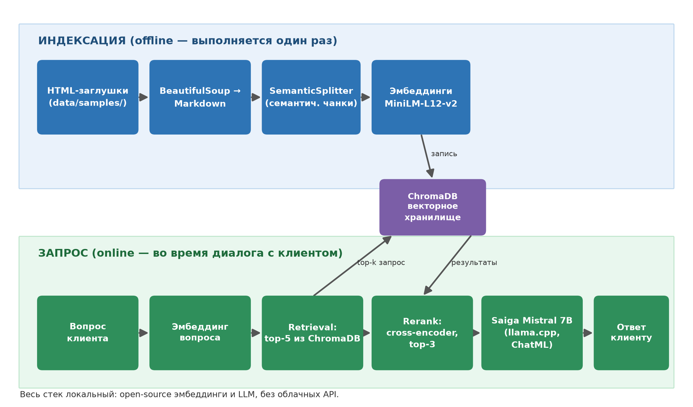

# Tire Shop RAG Assistant

RAG-ассистент для магазина шин на базе **LlamaIndex**,
локальной LLM в формате GGUF (**Saiga Mistral 7B** через `llama.cpp`) и **ChromaDB**.

Работает в двух интерфейсах над одним кодом:
- **CLI-скрипт** `main.py` — быстрый локальный запуск;
- **Jupyter-ноутбук** `notebooks/01_pipeline.ipynb` — пошаговый пайплайн в локальном Jupyter
  или в **Google Colab с GPU**.

> ⚠️ **Важно.** Все данные в репозитории — **фиктивные**.
> Парсеры работают на локальных HTML-заглушках из `data/samples/`.

## Возможности

- HTML → Markdown (BeautifulSoup, локальные заглушки в `data/samples/`);
- семантический чанкинг `SemanticSplitterNodeParser`;
- эмбеддинги `sentence-transformers/paraphrase-multilingual-MiniLM-L12-v2`;
- векторное хранилище **ChromaDB** (персистентное);
- реранк **cross-encoder** `mmarco-mMiniLMv2-L12-H384-v1` (top-3 из retrieval top-5);
- локальная LLM **Saiga Mistral 7B Q4_K_M** через `llama-cpp-python` (автоопределение GPU);
- ChatML-промпт с anti-hallucination ограничениями;
- минимальная evaluation (Q/A-пары + метрика «доля пройденных»).

## Архитектура



Пайплайн: `HTML (локальные заглушки) → BeautifulSoup → Markdown → SemanticSplitter →
эмбеддинги → ChromaDB → retrieval top-5 → rerank top-3 → Saiga (llama.cpp) → Ответ`.

Верхняя дорожка — **индексация** (offline, выполняется один раз), нижняя — **обработка запроса**
(online, по каждому вопросу клиента).

## Структура проекта

```
tire-shop-rag-assistant/
├── main.py                        # CLI-точка входа (сборка БЗ + evaluation)
├── requirements.txt               # зависимости
├── assets/
│   └── architecture.png           # схема пайплайна
├── data/
│   ├── samples/                   # HTML-заглушки (исходные данные)
│   └── *.md                       # генерируются парсерами (в git не хранятся)
├── evaluation/
│   └── qa_pairs.json              # QA-пары для проверки ответов
├── notebooks/
│   └── 01_pipeline.ipynb          # ноутбук: Colab / локальный Jupyter
└── src/
    ├── pipeline.py                # оркестрация: единый код для main.py и ноутбука
    ├── utils.py                   # утилиты (markdown, пути)
    ├── parsers/                   # HTML → Markdown (catalog, delivery, payment)
    └── rag/
        ├── embeddings.py          # модель эмбеддингов + семантический сплиттер
        ├── index.py               # построение векторного индекса в ChromaDB
        ├── engine.py              # LLM (llama.cpp) + query engine + reranker
        └── prompts.py             # ChatML-форматирование и anti-hallucination промпт
```

## Быстрый старт (локально, VS Code)

Требования: **Python 3.10+**, ~8 ГБ RAM. На диск понадобится ~6 ГБ на модели.

```bash
git clone https://github.com/Veskernout/tire-shop-rag-assistant.git
cd tire-shop-rag-assistant

python -m venv .venv
# Windows:
.venv\Scripts\activate
# Linux/macOS:
# source .venv/bin/activate

pip install -r requirements.txt

# Полный прогон: парсинг → индекс → скачивание LLM (~4.2 ГБ) → evaluation
python main.py

# Быстрый прогон без LLM (только сборка БЗ и индекса):
python main.py --skip-model

# Форсировать CPU (не оффлоадить слои модели в GPU):
python main.py --cpu
```

GPU-слои определяются автоматически по `nvidia-smi`/`torch.cuda` (`n_gpu_layers=-1` — GPU,
`0` — CPU). Для оффлоада в GPU важно, чтобы `llama-cpp-python` был собран с CUDA/ROCm.

## Запуск в Google Colab (GPU)

Откройте ноутбук по прямой ссылке:

```
https://colab.research.google.com/github/Veskernout/tire-shop-rag-assistant/blob/main/notebooks/01_pipeline.ipynb
```

1. В меню **Среда выполнения → Сменить среду выполнения** выберите **T4 GPU**.
2. В первой ячейке замените `GITHUB_USER = "Veskernout"` на свой никнейм (если нужно).
   (ноутбук сам склонирует репозиторий).
3. Запустите все ячейки (**Среда выполнения → Выполнить все**).

Что произойдёт при первом запуске:
- установка `requirements.txt`;
- пересборка `llama-cpp-python` под CUDA (~5–15 минут, только при активной GPU);
- скачивание моделей: эмбеддинги (~470 МБ), cross-encoder реранкер (~460 МБ), Saiga 7B (~4.2 ГБ);
- сборка базы знаний и индекса, прогон evaluation, интерактивный чат.

> В Colab модели и `chroma_db/` живут во временном диске — при потере сессии index
> и модели скачиваются заново.

## Запуск в локальном Jupyter / VS Code

Тот же `notebooks/01_pipeline.ipynb`: в локальной среде ячейка клонирования пропускается
(`IN_COLAB == False`), зависимости берутся из уже установленного окружения,
GPU-пересборка `llama-cpp-python` не выполняется.

## Пайплайн (в деталях)

1. `build_knowledge_base()` — `src/parsers/*` читают `data/samples/*.html`,
   пишут Markdown в `data/*.md` (файлы в git не хранятся, см. `.gitignore`).
2. `configure_embeddings()` — `HuggingFaceEmbedding` + `SemanticSplitterNodeParser`
   (глобально через `llama_index.core.Settings`).
3. `build_index()` — читает **только** `data/*.md` (`recursive=False`), очищает коллекцию
   ChromaDB перед пересборкой и индексирует узлы.
4. `ensure_model()` — скачивает GGUF-модель с Hugging Face Hub при отсутствии локального файла.
5. `build_query_engine()` — retrieval `top-5`, rerank `top-3`, `response_mode="compact"`.
6. `run_evaluation()` — прогон `evaluation/qa_pairs.json`, печать `[OK]/[MISS]` и сводки
   `Passed X/Y`.

## Evaluation

`evaluation/qa_pairs.json` — список вопросов c ожидаемыми ключевыми словами:

```json
{
  "question": "Какая цена у Demo Winter A 205/55 R16?",
  "expected_keywords": ["7990"]
}
```

Ответ считается пройденным, если в нём встречаются **все** ключевые слова (без учёта регистра).
Итог — доля пройденных вопросов (`Passed X/Y`).

## Замена модели / реранкера

Всё переопределяется переменными окружения (удобно для тестов на маленьких моделях):

| Переменная | По умолчанию |
|---|---|
| `RAG_MODEL_REPO` | `TheBloke/saiga_mistral_7b-GGUF` |
| `RAG_MODEL_FILE` | `saiga_mistral_7b.Q4_K_M.gguf` |
| `RAG_MODEL_DIR` | `./models` |
| `RAG_RERANK_MODEL` | `cross-encoder/mmarco-mMiniLMv2-L12-H384-v1` |

Пример быстрой проверки пайплайна на маленькой модели:

```powershell
$env:RAG_MODEL_REPO = "Qwen/Qwen2.5-0.5B-Instruct-GGUF"
$env:RAG_MODEL_FILE = "qwen2.5-0.5b-instruct-q4_k_m.gguf"
python main.py --cpu
```

## Ограничения

- Все данные фиктивные; парсеры рассчитаны на HTML-заглушки, а не на реальные сайты;
- Saiga 7B на CPU отвечает медленно (для продакшена нужен GPU или модель поменьше);
- evaluation минимальная (10 пар, проверка по ключевым словам, без метрик качества retrieval);
- в Colab диск эфемерный: после потери сессии модели и индекс скачиваются повторно.

## Стек

- `llama-index` 0.10.x (core, embeddings-huggingface, llms-llama-cpp, vector-stores-chroma)
- `chromadb` 0.5.x · `sentence-transformers` 3.x · `llama-cpp-python` 0.2.x
- `beautifulsoup4` · `huggingface-hub` (зависимости зафиксированы в `requirements.txt`)

